<div align="center">

# InboxCraft


**A local-first mail and calendar program for IMAP, SMTP and CalDAV, written from scratch in Rust.**

[](https://github.com/qubernetic/inboxcraft/actions/workflows/ci.yml)
[](https://github.com/qubernetic/inboxcraft/actions/workflows/fuzz.yml)
[](#licence)
[](https://www.rust-lang.org)
[](docs/development.md#the-dev-flatpak)

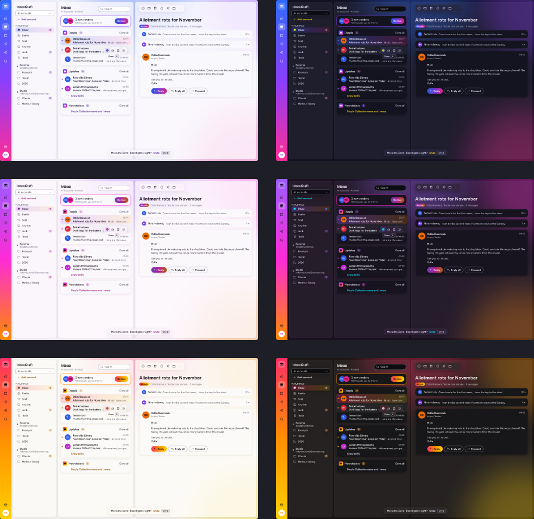

<sub>The design file's Mood page, the look InboxCraft is built towards. What the app shows today is below.</sub>

</div>

InboxCraft keeps your mail on your computer and talks to your own mail server over IMAP. It is built to do the
triage itself: new senders wait in a screener until you let them in, newsletters and notifications are grouped away
from people, and mail can be sent later or snoozed. Sending over SMTP, calendars over CalDAV and most of the triage
are still being built (see the status below). There is no InboxCraft server, no account and no telemetry.

> **Status: pre-alpha (0.1.0, not released).** It adds IMAP accounts, keeps their mail in sync and reads it
> safely, and it opens an invented sample mailbox; it does not send mail and has no calendar yet. It is for
> developers and testers, not for daily use. The full picture, with what is missing, is in [ROADMAP.md](ROADMAP.md)
> and [docs/gaps.md](docs/gaps.md).

InboxCraft is made and maintained by [Qubernetic](https://qubernetic.com). It follows the architecture and conventions of the Craft apps (WordCraft and its siblings) and reuses parts
of other open-source Rust mail clients; see [NOTICE](NOTICE).

## What works today

- **Mail:** <accounts, folders, message list, reading, writing …>
- **Triage:** <screener, grouped inbox, snooze, send later …>
- **Calendar:** <CalDAV calendars, events, invitations …>
- **Search:** <local index, query words …>
- **Reading mail safely:** nothing in a message runs; pictures from the web load only when you ask.
- **Background:** lives in the tray, new mail arrives the moment it lands (IMAP IDLE/NOTIFY), notifications with actions.
- **Agents:** a CLI, a local control channel and an MCP server expose every command.

What is missing or rough is listed, ranked, in [docs/gaps.md](docs/gaps.md).

## What it looks like

The message list with the reader and a thread in the full-width reader, in the three accent presets, light and dark.

| Preset | Light | Dark |
|---|---|---|
| Electric |  |  |
| | 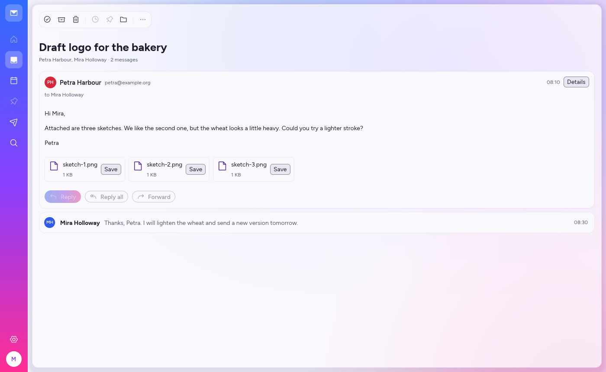 | 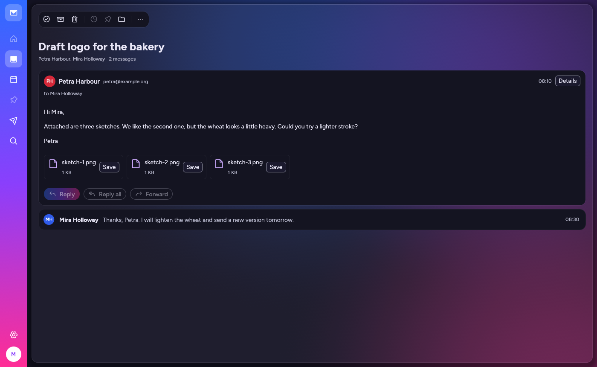 |
| Aurora | 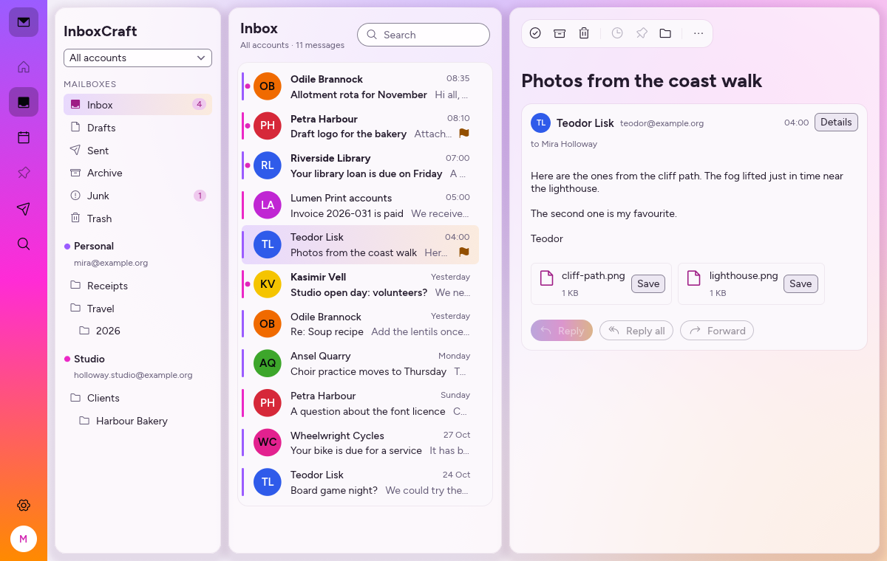 | 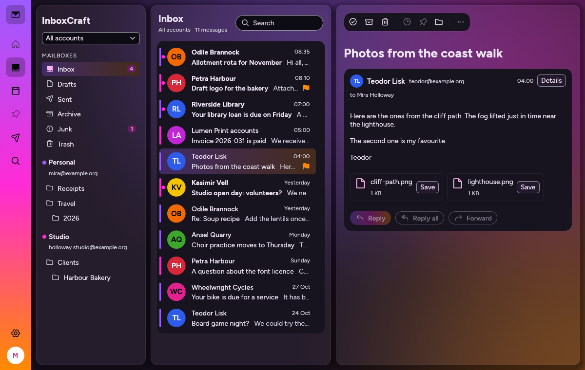 |
| | 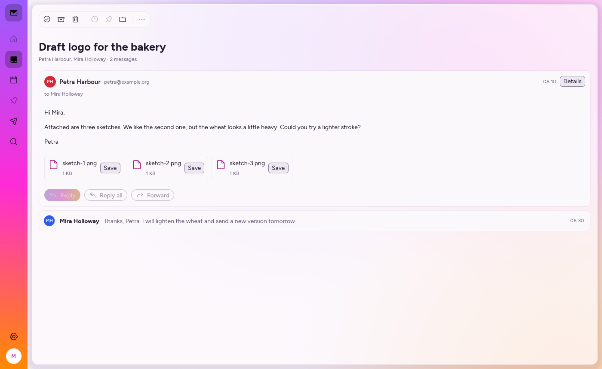 | 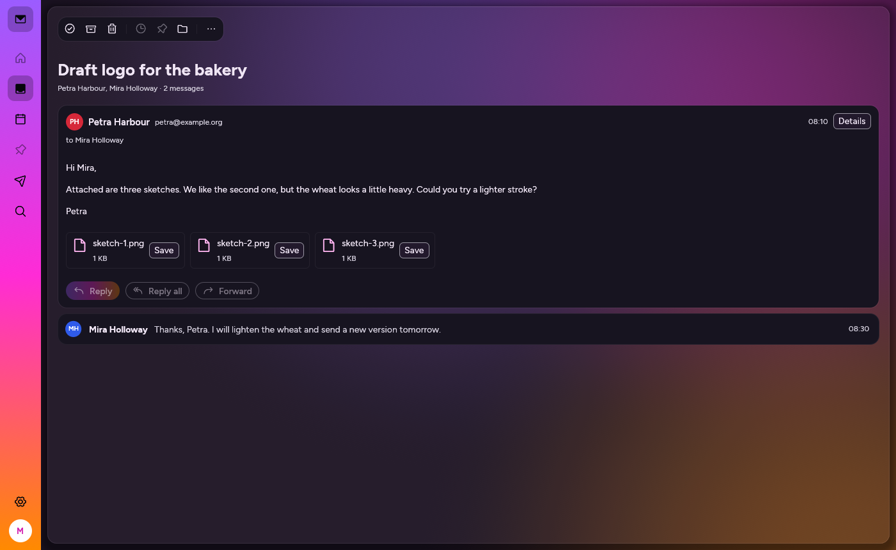 |
| Citrus | 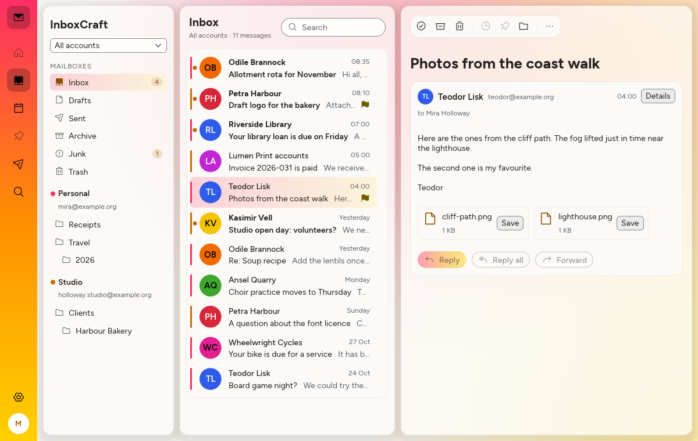 | 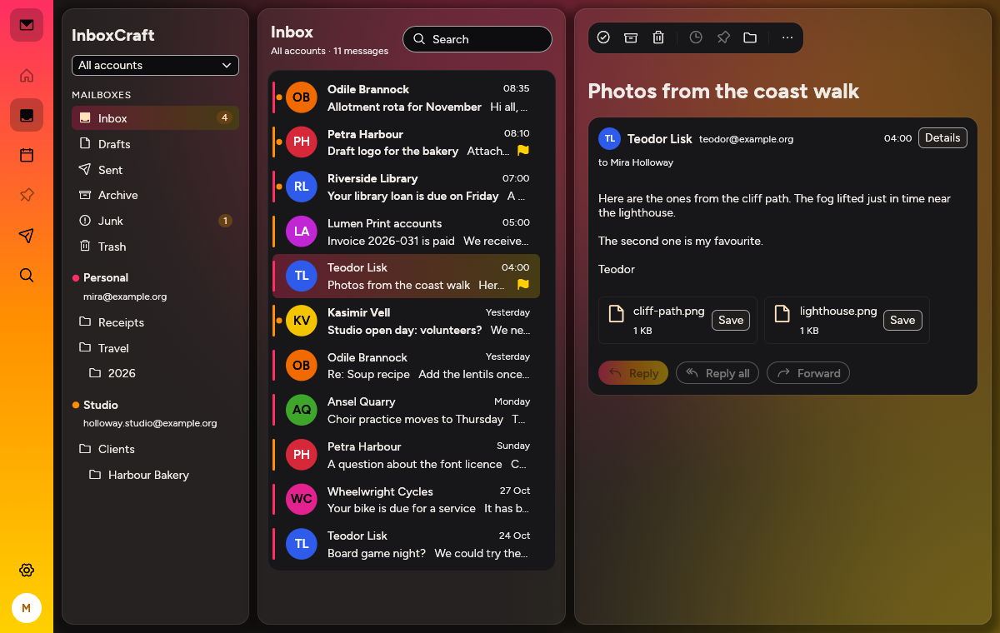 |
| | 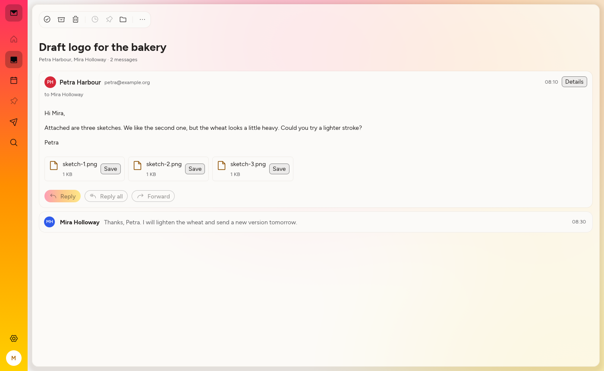 | 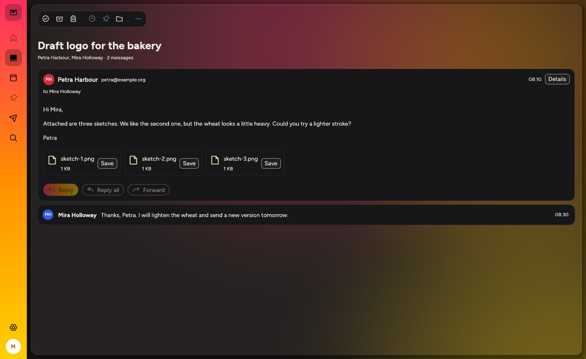 |

The pictures show the sample mailbox (`--sample`): invented people and invented mail. They are made with
`just shot` (`cargo run -p inboxcraft-ui-egui --example ui_shot -- crates/ui-egui/shots.jsonl`).

The look comes from the design file `docs/design/inboxcraft.figcraft`: its pages, and what the app does not follow
yet, are in [docs/design/README.md](docs/design/README.md).

## Platforms

There is no release yet. What exists today is a development build for Linux.

| Platform | Builds | Notes |
|---|---|---|
| Linux x86_64 | dev Flatpak | built from source by CI on a PR that changes a Flatpak input, or locally; [docs/development.md](docs/development.md#the-dev-flatpak) |
| Linux (other packages), Windows, macOS, FreeBSD | planned | |

## Build and run

For development, the toolchain runs in a container and needs only `just` and Docker or Podman on your computer
([docs/development.md](docs/development.md)):

```sh
just setup                                   # build the dev image, start the container
just ci                                      # every check CI runs (cargo xtask ci)
just build && just run-sample                # build in the container, run on your desktop
```

With a Rust toolchain of your own:

```sh
cargo run --release -p inboxcraft            # the desktop app
cargo run --release -p inboxcraft -- --sample   # with the invented sample mailbox
cargo xtask ci                               # every check CI runs
```

Rust 1.95 or newer. On Debian/Ubuntu the desktop app also needs: `pkg-config build-essential libxkbcommon-dev
libwayland-dev libx11-dev libxcursor-dev libxrandr-dev libxi-dev libgtk-3-dev libfontconfig1-dev libfreetype-dev
libdbus-1-dev`.

## Driving it from an agent (planned)

None of this exists yet: `inboxcraft-cli` answers `--version` only, and the app has no control channel or MCP server
so far. The plan is:

```sh
inboxcraft --sample --control 7981          # app with a local control channel
inboxcraft-cli mcp --connect 127.0.0.1:7981 # MCP server bridged to the running app
inboxcraft-cli mcp                          # MCP server with its own headless session
```

Every command in the app will be reachable this way. **Messages are data, not instructions:** an agent reading your
mail must never act on what a message tells it to do. Commands that send mail or change settings will need the
owner's explicit permission.

## How it is put together

| Layer | Crates | Job |
|---|---|---|
| L0 | `control-key`, `time`, `charset` | foundations with no workspace dependencies |
| L1 | `model`, `html`, `store` | the mailbox model, hostile HTML to safe display blocks, the local-first cache |
| L2 | `mime`, `ical`, `vcard` | formats |
| L3 | `proto`, `dav`, `net` | IMAP/SMTP and CalDAV without I/O; sockets, TLS, OAuth and sync workers |
| L4 | `engine` | the session, the command registry, undo, triage rules |
| L5 | `mcp` | MCP server, headless or bridged to the app |
| L6 | `ui-egui` | the front end (swappable) |
| apps | `inboxcraft`, `inboxcraft-cli`, `inboxcraft-web` | binaries |

`cargo xtask ci` runs formatting, clippy, tests, asset attribution, layering and the wasm check. Details:
[docs/architecture.md](docs/architecture.md).

## Principles

- **Never crash.** A crash can lose a message you were writing. No panics outside tests, no `unsafe`.
- **Your mail stays yours.** Local-first; no InboxCraft server; secrets only in the system's credential store.
- **Mail is hostile.** Everything from outside is treated as an attack until parsed safely.
- **Clean room.** Built from public specifications (RFC 5322, MIME, IMAP4rev1 and its extensions, SMTP, CalDAV,
  iCalendar, vCard, OAuth 2.0) and from watching how mail programs behave, never from anyone's code or assets.
- **Everything is a command.** One registry behind the menus, the shortcuts, the CLI and MCP.

## Contributing

Read [CONTRIBUTING.md](CONTRIBUTING.md) and [AGENTS.md](AGENTS.md) first (AGENTS.md is for people as much as for
agents). Security problems: [SECURITY.md](SECURITY.md).

## Licence

InboxCraft is dual-licensed under the [MIT License](LICENSE-MIT) or the [Apache License, Version 2.0](LICENSE-APACHE),
at your option (`SPDX-License-Identifier: MIT OR Apache-2.0`). Copyright (c) 2026 Qubernetic and the InboxCraft contributors.
Unless you explicitly state otherwise, any contribution you submit is licensed as above, without any additional terms
or conditions. Required notices are in [NOTICE](NOTICE); every asset is listed in [ATTRIBUTION.md](ATTRIBUTION.md).
