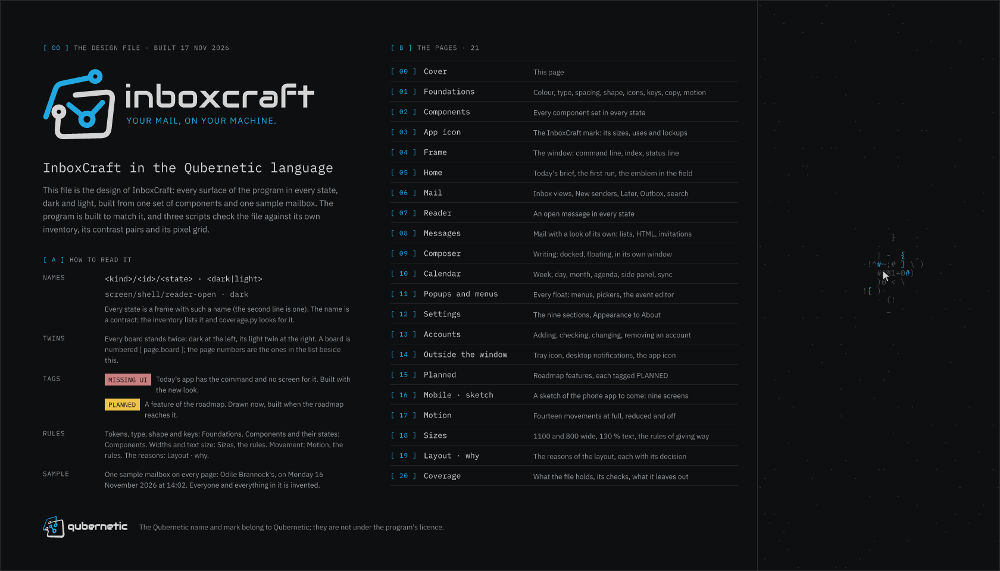

# InboxCraft design file

> **Last reviewed:** <date> · **Last updated:** 2026-11-17 · **Change:** major · **Status:** draft

`inboxcraft.figcraft` is the design file of the whole app, made in
[FigCraft](https://getartcraft.com/apps/figcraft): InboxCraft in the form language of the Qubernetic brand. **It is
the source of truth for the look.** [`docs/design.md`](../design.md) puts its rules and tokens into words. A change
of look starts in the file.

**The app follows most of this file.** It replaced the earlier glass and gradient design file on 2026-11-17; the
frame, Home, the lists, the reader, the composer, the calendar, the settings and the motion levels are built to it,
and the screenshots in `docs/images/` show the new look. What the app still owes the file is listed under
[Not in the code yet](#not-in-the-code-yet).

Every person, address and message in the file is invented (`example.org`).

`cover.png` is the one picture of a page kept here. Rendered pages are tens of megabytes and change with every
build, so open the file in FigCraft to see the rest.

## Opening it
Open `inboxcraft.figcraft` in FigCraft (File ▸ Open). The file names IBM Plex Mono, IBM Plex Sans and Audiowide (all
under the SIL Open Font Licence) and embeds no font file. FigCraft shows only installed typefaces, so install the
three first; without them it falls back to another typeface.

## Pages
| Page | Holds |
|---|---|
| Cover | The title page, how to read the file, the list of pages |
| Foundations | Colour in dark and light with the contrast of every pair, six account colours, type, spacing, shape, icons, focus and keys, the wording rules, motion in three levels, the character field, the "coming soon" rule |
| Components | 64 components as FigCraft components with variants, every state in dark and light |
| App icon | The InboxCraft mark: its three drawings by size, the size ladder, the mark in the command line, the tray and the app icon, the wordmark and lockups, clear space and minimum sizes |
| Frame | The window: the command line with its result lists, the index with one to six accounts and forty folders, the status line with every state and notice, the own and the system window frame |
| Home | The brief of the day with counts, agenda and drafts; nothing to do, overflowing counts, the first run, everything failing at once |
| Mail | The inbox in its three views (Grouped, Smart, List) with empty, no match, show done and a row leaving; the screener card, New senders in the three screener modes, Later, Outbox, search, Sent, a folder, Drafts, the welcome screen; long text and counts |
| Reader | The reader with its facts, why line and content bar; the states when the text is not there, the five picture states, link status, a conversation, a held sender, full width, the reader in its own window |
| Messages | Eight kinds of mail in the fitted and the plain text view: mailing list, marketing, receipt, forge, pictures, newsletter, invitation, bounce; the original opened in the browser from a cleaned copy |
| Composer | The composer docked, as a floating panel and in its own window, ten states each; long text, Cc and Bcc |
| Calendar | Week, day, month and agenda with overlapping events, the all-day lane, the now line and zones; the side panel, event details, the empty calendar, the sync control |
| Popups and menus | Every float: the More and Move menus, the time picker for snooze, send later and reminders, the event editor, the account picker, suggestions, templates, the day's events in the month, the question before an attachment opens |
| Settings | The nine sections, Appearance to About, as a second column beside the index with the section's page |
| Accounts | Adding an account, what detection asked and where, the check line by line as it runs, its failures in plain words, changing and removing an account |
| Outside the window | The tray icon and its menu, desktop notifications, the app icon on the desktop |
| Planned | Features of the roadmap, each tagged PLANNED: search in the text, bulk select, attachments on a draft, editing a series, OAuth, machine text and an agent's request, the log drawer, setting up a phone, smart folders, and one example of a plugin building in through standard places |
| Mobile · sketch | Nine phone screens as a direction to look at, not a specification |
| Motion | Fourteen movements, each at full, reduced and off, and two flows as sequences of whole windows |
| Sizes | The same screens at 1100 and 800 wide and at 130 % text, with the breakpoints written as rules |
| Layout · why | The reasons of the layout, each with its decision |
| Coverage | What the file holds, its checks, and what it leaves out |
| Event drafts | Tagged PLANNED: a half-typed event kept as a draft, shown in the calendar at its time, never sent, kept only on this computer and asked about once its time has passed |
| Event editor | Tagged PLANNED: the event editor in three places, as the composer has three, and the event's description |

## How it is organised
- **Colours are variables.** The Colour collection has a Dark and a Light mode and one variable per token; fills,
  strokes and text colours are bound to them, so a frame shows in the other mode by switching its Colour mode.
  Distance, Motion and Text size are collections of their own; Text size has the mode `130 %`.
- **Type is text styles**, bound to the Text size collection.
- **Screens use instances.** Rows, buttons, fields and the rest are instances of the Components page, set through
  their properties.
- **Every state is drawn twice,** dark at the left and its light twin at the right. A state is a frame named
  `<kind>/<id>/<state>`.
- **Tags.** MISSING UI: the app has the command and no screen for it yet. PLANNED: a feature of the roadmap, drawn
  now. Both are notes of the file. The dashed "coming soon" mark is part of the app: it stands on a surface that is
  shown and not implemented yet.
- **Size:** windows are 1440 × 900 points; the phone sketches are 390 × 844.

The file is checked when it is built: every listed state is present (1 902 named frames), every text and edge
colour pair reaches its WCAG contrast (142 pairs), no edge misses the line it belongs to by a pixel, and the sample
mailbox says the same on every page.

## The marks
The InboxCraft mark and wordmark and the Qubernetic mark, wordmark and emblem shown in the file and in `cover.png` are
by Qubernetic under CC BY-ND 4.0 (shared unchanged, with credit), not under the MIT or Apache licence of the rest of
this repository, and remain trademarks of Qubernetic; see `NOTICE`.

## Not in the code yet
What the app still owes this file, one line each. The finer differences, with their numbers, are in
[`docs/gaps.md`](../gaps.md).

**Windows**
- The reader and the composer in a window of their own (Reader, Composer) are not built: Appearance › Layout shows
  both rows coming soon.
- With the own window frame the desktop's window menu is not offered on a right press of the command line.
- A window narrower than 800 is laid out 800 wide and clipped at its right.
- New message at the top of the index (Frame › Index) is not built (#339).
- The index still draws Drafts with the compose pencil, not the file's dashed page (`file-dashed`) (#339).

**Where the composer lives**
- The composer is docked in the reader's place or floats; its window of its own is not built, and which place it
  opens in by default is not settled yet.

**Messages**
- The fitted view does not yet draw a message's backgrounds, buttons, alignment and table widths as the Messages
  page does, and the original cannot be opened in the browser from a cleaned copy.
- A reply's quote is plain `> ` lines in the body, not the file's quote block.

**Event drafts and the event editor**
- A half-typed event is not kept as a draft; while the editor is open the command line offers only the editor's
  and the window's commands. The file does not draw event drafts yet either.

**The marks**
- The file draws Home only in a window 900 high. In a lower one the code pulls the emblem and the names under it up
  toward the top of their place, and drops them only where even that leaves no room. The line "↳ the field reacts
  under the pointer here, and only here" is a note on the design, not drawn; the names' box keeps its room.

**Sample content**
- The sample mailbox and the pictures in `docs/images/` use their own people, subjects, times and counts, not the
  file's, and no picture shows the status line's notice, a refused account or everything failing.

**Waiting for the file to be redrawn**
- The owner's rulings of 2026-11-18 are in the code but not yet in this file: the invitation card has one primary
  answer and keeps "Keep my answer", and the add form's Detect and "Check and add" can always be pressed.

**Frame, command line and status line**
- The command line's search of all mail, its GO TO and LAST COMMANDS groups and mixed results are not built; plain
  text searches the mail shown.
- The status line says "offline" with no time since and no "try again", the send countdown has no "send now", and
  its first failure is the first failing account, not the worst.
- Every "open log" is coming soon: there is no log to open.
- On Home, the calendar, the settings and in one pane the status line keeps the mail's key hints.
- The index keeps Blocked, Junk and Screener rows the file does not draw, names a folder under another by its whole
  path, and shows every account's sync state as quiet.

**Home**
- No source yet for "offline since" or a refused sign-in: the failing banner names refused sends only, on one line.
- "Look around with sample mail" is coming soon; Home shows two drafts where one frame draws three.

**Lists and the reader**
- Later is the inbox's group heads over the snoozed mail, not the file's page with scheduled sends and pins.
- The why line leaves out what the engine does not keep: when a sender was let in, a move by the owner, SPF and
  DKIM.
- At 130 % text the list's view switch stands on the pills' line, not in the head.

**Settings and the calendar**
- The confirmation dialogs stand by what they ask about as the file's rule says, but what they ask about stands
  elsewhere: the Templates page lists Personal before Studio and the Scheduled page the sample's four entries, so
  the row asked about is not where the frames have it and the cards stand off the frames' y 423 and 441 of 900; the
  account form draws "Remove account…" at 664 where the frame has 602, so its card is at 324, not 262. A
  scheduled send's says "“…” will not go at its time, Tue 08:00." where the frame says "on Tuesday at 08:00", and an
  account's says "its drafts" where the frame counts them.
- The settings are drawn to the 1440 frames; under about 1060 their narrow sizes are the code's own.
- Privacy keeps no sender name, so a row shows the address at 16 where the frames draw a name column; About is one
  column, and "After an act" and the week's two rows on Calendar have no frame.
- The calendar's sync line has no "sync now" link at rest; the line itself takes the press.
- Sending's "Your name", the choice of the word Home greets you by, has no frame.

## Limits
- The Planned page shows direction: where a feature stands and how it looks. Numbers and steps in it are invented,
  and each feature's behaviour is decided when it is designed. The plugin example and the mobile sketch are ideas
  for the future, not plans with a date.
- Motion is drawn as still key frames with their times; the file plays nothing.
- The picture of the phone code on the Planned and Mobile pages is a placeholder and decodes to nothing.
- Google and Microsoft 365 accounts are left out on purpose.

## Revision history
| Date | Change | Summary |
|---|---|---|
| 2026-11-06 | major | First version: foundations, components, screens of the whole app, mood, scenarios (#96) |
| 2026-11-06 | minor | Transparent pages; white text on a darkened text gradient where it reads at 4.5:1 (#96) |
| 2026-11-06 | minor | Group headers show an outline icon without a background (#96) |
| 2026-11-06 | minor | The composer fills the reader's place or opens in a window of its own (#96) |
| 2026-11-06 | minor | The scenarios also in Electric dark (#96) |
| 2026-11-06 | minor | Dark mode's accent: the middle stop lightened instead of the separate accent (#96) |
| 2026-11-06 | major | The file is the source of truth for the look; its changes not yet in the code are listed (#96) |
| 2026-11-06 | minor | The window frame page and the new app icon on the cover; every listed change is in the code (#104) |
| 2026-11-06 | minor | Accounts are added and listed on the settings sheet; the folder pane has no Add account (#104) |
| 2026-11-08 | minor | The notifications screen's other rows live on the Triage and Sending pages (#139) |
| 2026-11-08 | minor | The calendar's views are built; the event editor and invitations are not yet (#147) |
| 2026-11-08 | minor | The event editor is built (#148) |
| 2026-11-08 | minor | The invitation screen is built (#149) |
| 2026-11-08 | minor | Translucent cards, one even selection, white on custom colours, segmented and select controls; the app's new screens and flows; a custom colour example; every float solid (#203) |
| 2026-11-08 | minor | The Planned and Later pages: every feature still to come, the rule-based smart features, with eight more flows (#203) |
| 2026-11-08 | minor | Cards, selection, white on custom colours and floats are in the code; the event tokens are, their painting is not (#205) |
| 2026-11-08 | minor | Controls and events in the calendar are in the code (#206) |
| 2026-11-08 | minor | The account form, an account's settings and the check after a change (#216) |
| 2026-11-17 | minor | The Qubernetic design file, first part, beside the present one (#222) |
| 2026-11-17 | minor | The Qubernetic design file, second part: the frame and the main screens (#224) |
| 2026-11-17 | major | The Qubernetic design file takes the place of the earlier one (#226) |
